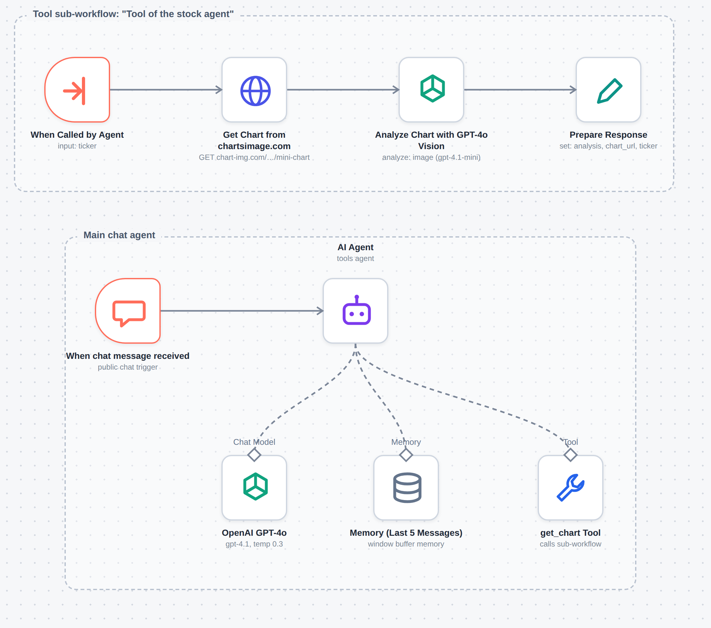
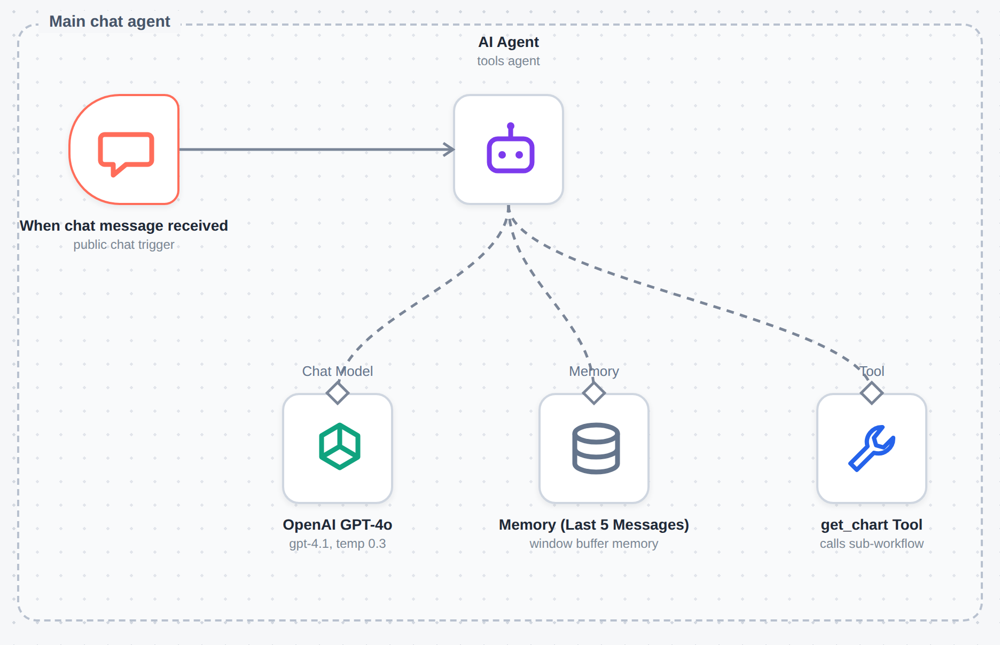
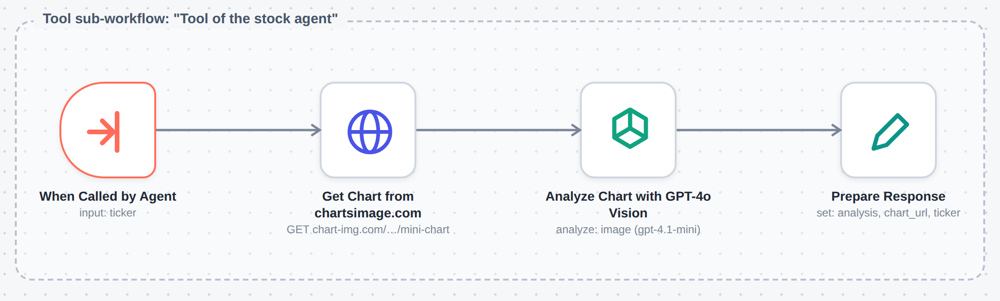

# Stock Analysis Agent (n8n)

  

Ask a chat assistant "Can you analyze Apple?" and it fetches a chart, reads it with a vision model, and answers with a structured technical breakdown: trend, recent price action, support and resistance, MACD, volume, RSI and overall sentiment. Ask it to compare Tesla with Nvidia and it does the lookup twice and compares the two.

This repo is the n8n export of that agent. There is nothing to compile. Import the JSON, add two credentials, and chat.



*Canvas view drawn from the exported JSON (node positions and connections come straight from the file). It is not a capture of a live n8n instance.*

## How it works

The JSON holds two small workflows that work as a pair.

### 1. The chat agent



A public **chat trigger** passes each message to an **AI Agent** node. The agent runs on OpenAI `gpt-4.1` at temperature 0.3 and keeps a short **window memory** (the node is named "Last 5 Messages") so follow-ups like "and what about Microsoft?" still make sense.

The system prompt does most of the work. It tells the agent to:

- turn company names into tickers (Apple to AAPL, Microsoft to MSFT, Amazon to AMZN, Google to GOOGL, Tesla to TSLA, Meta to META, Nvidia to NVDA)
- call the `get_chart` tool once per stock, including when comparing several
- present the result under fixed headings and finish with a Key Takeaways section
- return the chart as a markdown image
- never give specific buy or sell advice, and always say the analysis is educational
- warn the user when a stock is not on NASDAQ

`get_chart` is an **Execute Workflow tool**. It hands the ticker to the second workflow and brings back whatever that workflow returns.

### 2. The chart analysis tool



Four nodes, in a straight line:

1. **When Called by Agent** receives a `ticker` input.
2. **Get Chart** calls the chart-img.com TradingView mini-chart endpoint (3 month interval) and keeps the response as a PNG file.
3. **Analyze Chart** sends the image to OpenAI's image analysis (`gpt-4.1-mini`) with a prompt that asks for seven sections: overall trend, recent price action, support and resistance, MACD, volume, RSI, and sentiment, plus the educational disclaimer.
4. **Prepare Response** packs the result into three fields, `analysis`, `chart_url` and `ticker`, for the agent.

## Setting it up

You need an n8n instance, an OpenAI API key and a chart-img.com API key.

1. Import [`workflow/stock-analysis-agent.json`](workflow/stock-analysis-agent.json). Both workflows come in on one canvas.
2. Move the four tool nodes (**When Called by Agent** through **Prepare Response**) into their own workflow and name it "Tool of the stock agent".
3. In the **get_chart Tool** node, pick that workflow (the export has a `REPLACE_WITH_TOOL_WORKFLOW_ID` placeholder).
4. Add your OpenAI credential to the chat model node and the image analysis node.
5. In **Get Chart**, replace `YOUR_CHART_IMG_API_KEY` in the Authorization header with your own key. Better still, move it into an n8n credential.
6. Open the chat, type a company name.

The export has had its instance ID and the original API key removed.

## Things to fix before you rely on it

Reading the export closely turns up a few gaps. They are all small, and the first one matters.

- **The chart symbol is hardcoded.** The Get Chart node asks for `BINANCE:ETHUSDT`, and the `ticker` the agent passes in is never used. As exported, every request would analyze the same Ethereum chart. Setting the symbol to an expression like `NASDAQ:{{ $json.ticker }}` would fix it.
- **The input name does not match.** The tool sends `Ticker` (capital T, default value `MSFT`) while the sub-workflow trigger expects `ticker`.
- **`chart_url` is always empty.** The chart is downloaded as a file and never hosted anywhere, so there is no URL to give back, even though the agent is told to return one.
- **Node names lag behind the models.** Several nodes are labeled GPT-4o while the settings say `gpt-4.1` and `gpt-4.1-mini`.
- **The mini chart may not show everything the prompt asks about.** The prompt wants MACD, volume and RSI. I have not checked which panels this endpoint actually draws.

## Ideas for next steps

- Fix the symbol and input name, then test with three or four tickers to confirm each one gets its own chart.
- Upload the PNG to storage and return a real `chart_url`.
- Connect the chat trigger to Telegram, which the system prompt already assumes.
- Add a price data source so the analysis is not based on a picture alone.

## Repository layout

```
.
├── README.md
├── workflow/
│   └── stock-analysis-agent.json
└── screenshots/
    ├── 01-workflow-canvas.png
    ├── 02-chat-agent-flow.png
    └── 03-chart-analysis-tool-flow.png
```

## Author

Romith
GitHub: [@ismam-tasnime](https://github.com/ismam-tasnime)
